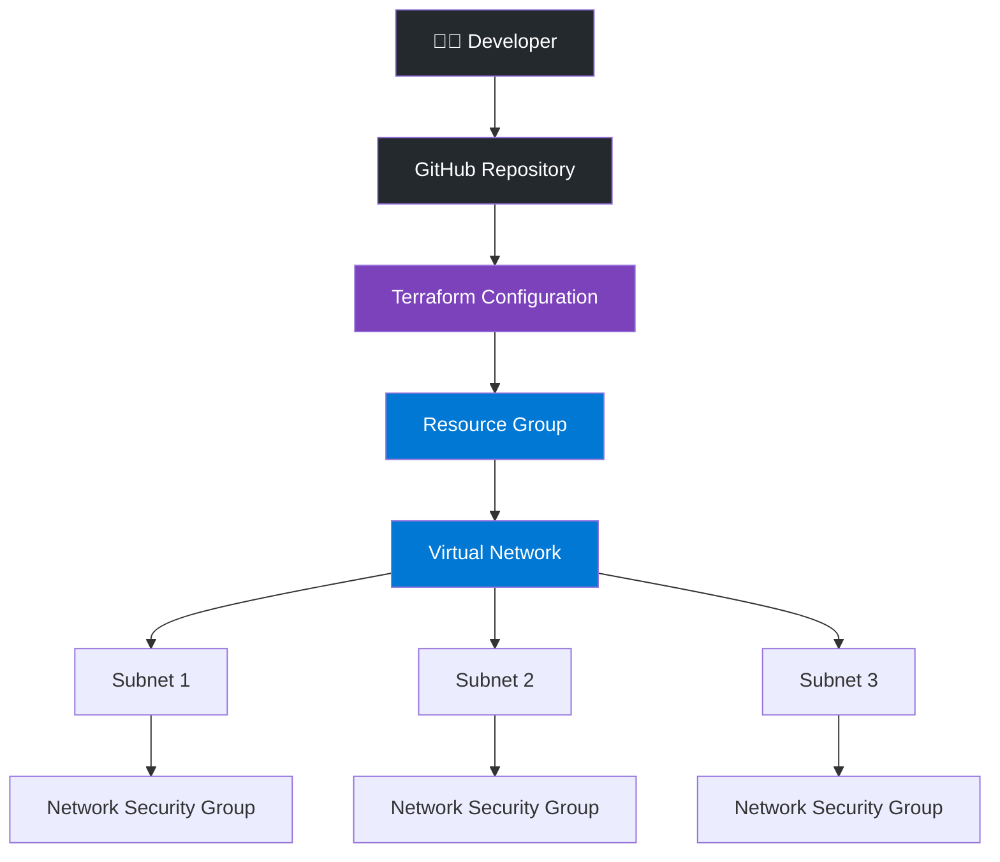
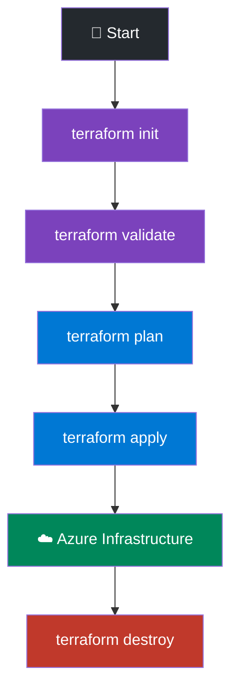

<div align="center">

# 🚀 Azure Infrastructure Automation using Terraform


### ☁️ Microsoft Azure | Terraform | IaC | Cloud Automation

<br/>


<br/><br/>


</div>

---

## 📌 Project Overview

This project demonstrates automated provisioning of **Microsoft Azure infrastructure using Terraform**.

The infrastructure is managed using **Infrastructure as Code (IaC)** principles, making deployments repeatable, consistent, and easy to maintain.

The project uses **reusable Terraform modules** and **`for_each`** to dynamically create multiple Azure resources without repeating resource blocks.

### 🎯 Project Objectives

* Automate Azure infrastructure provisioning.
* Implement Infrastructure as Code.
* Build reusable Terraform modules.
* Create multiple Azure resources dynamically.
* Manage infrastructure using Terraform variables.
* Maintain infrastructure code using Git and GitHub.

---

## 🛠️ Technologies Used

<div align="center">

| Technology                | Purpose                     |
| :------------------------ | :-------------------------- |
| ☁️ Microsoft Azure        | Cloud Infrastructure        |
| 🟣 Terraform              | Infrastructure as Code      |
| 🔷 Azure Resource Manager | Azure Resource Management   |
| 🌐 Azure Networking       | Virtual Network and Subnets |
| 🔀 Git                    | Version Control             |
| 🐙 GitHub                 | Source Code Management      |
| ⚙️ IaC                    | Infrastructure Automation   |

</div>

---

## 🏗️ Azure Resources

This project provisions the following Azure infrastructure:

| Azure Resource                | Description                   |
| :---------------------------- | :---------------------------- |
| Resource Group                | Organizes Azure resources     |
| Virtual Network (VNet)        | Provides private networking   |
| Multiple Subnets              | Divides network into segments |
| Network Security Groups (NSG) | Controls network traffic      |

### 🏛️ Infrastructure Architecture



---

## 📂 Project Structure

```text
azure-terraform-infrastructure/
│
├── README.md
├── .gitignore
│
├── modules/
│   ├── resource_group/
│   │   ├── main.tf
│   │   └── variables.tf
│   │
│   └── vnet/
│       ├── main.tf
│       └── variables.tf
│
└── environments/
    └── dev/
        ├── main.tf
        ├── provider.tf
        ├── variables.tf
        └── terraform.tfvars
```

---

## 🔁 Terraform `for_each`

This project uses Terraform's **`for_each` meta-argument** to create multiple resources dynamically.

### Example: Subnet Creation

```hcl
variable "subnets" {
  type = any
}

resource "azurerm_subnet" "subnet" {
  for_each = var.subnets

  name                 = each.key
  address_prefixes     = [each.value]
  resource_group_name  = var.resource_group_name
  virtual_network_name = var.virtual_network_name
}
```

### ✨ Benefits of `for_each`

* ♻️ Reduces code duplication.
* ⚡ Creates multiple resources dynamically.
* 🔧 Makes Terraform configuration reusable.
* 📦 Makes infrastructure easier to maintain.
* 🗂️ Allows resources to be managed using maps.

---

## 🧩 Terraform Modules

This project uses reusable Terraform modules to organize infrastructure.

### 1. Resource Group Module

📁 `modules/resource_group/`

Responsible for creating and managing Azure Resource Groups.

### 2. VNet Module

📁 `modules/vnet/`

Responsible for creating Azure Virtual Networks and related networking resources.

---

## 🌍 Development Environment

📁 `environments/dev/`

The development environment contains:

| File               | Description                  |
| :----------------- | :--------------------------- |
| `main.tf`          | Module configuration         |
| `provider.tf`      | Azure provider configuration |
| `variables.tf`     | Input variable definitions   |
| `terraform.tfvars` | Environment-specific values  |

---

## ⚙️ Terraform Workflow

<div align="center">



</div>

### 1. Initialize Terraform

```bash
terraform init
```

### 2. Validate Configuration

```bash
terraform validate
```

### 3. Create Execution Plan

```bash
terraform plan
```

### 4. Deploy Infrastructure

```bash
terraform apply
```

### 5. Destroy Infrastructure

```bash
terraform destroy
```

---

## 🔐 Security Best Practices

* Never commit passwords or credentials to GitHub.
* Exclude Terraform state files from version control.
* Exclude the `.terraform/` directory.
* Use secure Azure authentication methods.
* Manage sensitive information securely.
* Follow the principle of least privilege.

---

## 🎯 Key Learning Outcomes

Through this project, I practiced:

* ☁️ Azure Infrastructure Provisioning
* 🏗️ Terraform Configuration
* 📦 Terraform Variables
* 🧩 Reusable Terraform Modules
* 🔁 Terraform `for_each`
* ⚡ Dynamic Resource Creation
* 🌐 Azure Networking
* 🔐 Infrastructure as Code (IaC)
* 🔀 Git Version Control
* 🐙 GitHub Repository Management

**🚀 Project Status**
<p align="center">
  
</p>
---

## 👨‍💻 Author

<div align="center">

# Abhishek Singh


[](https://github.com/abhisheksingh-devops)

### Building 🚀 Automating ⚙️ Learning 📚


</div>
